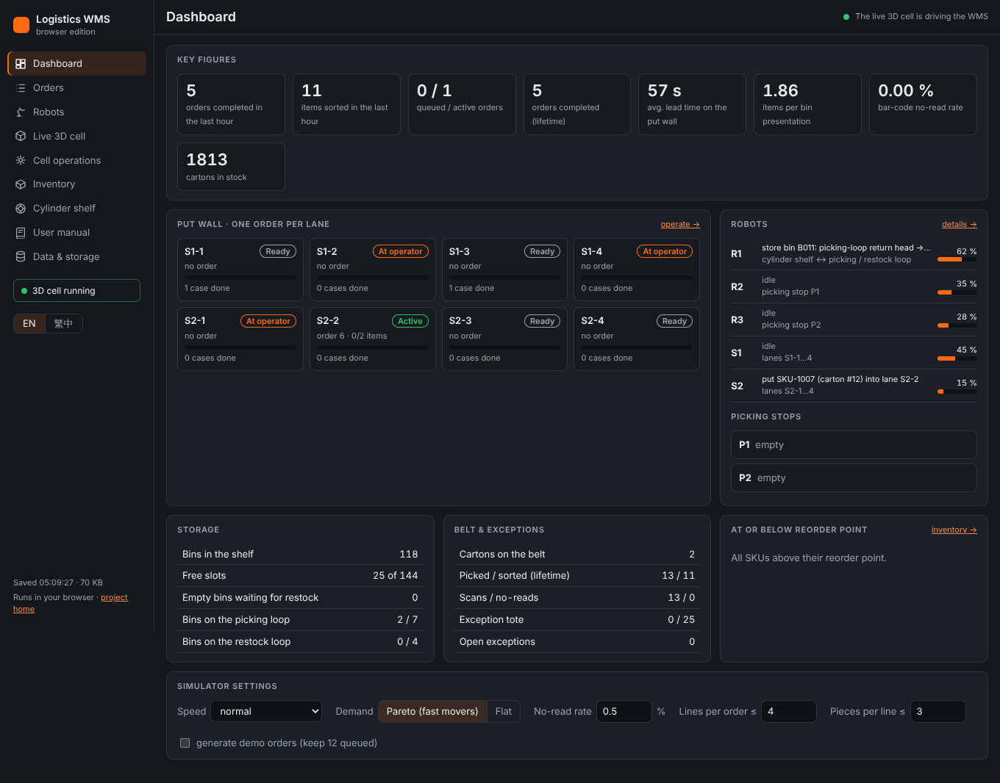
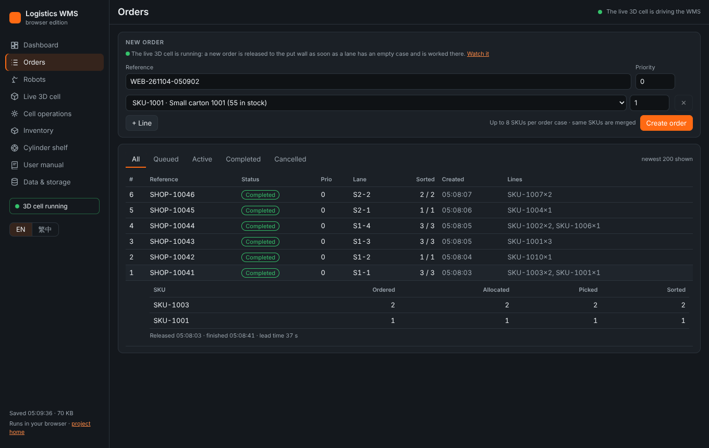
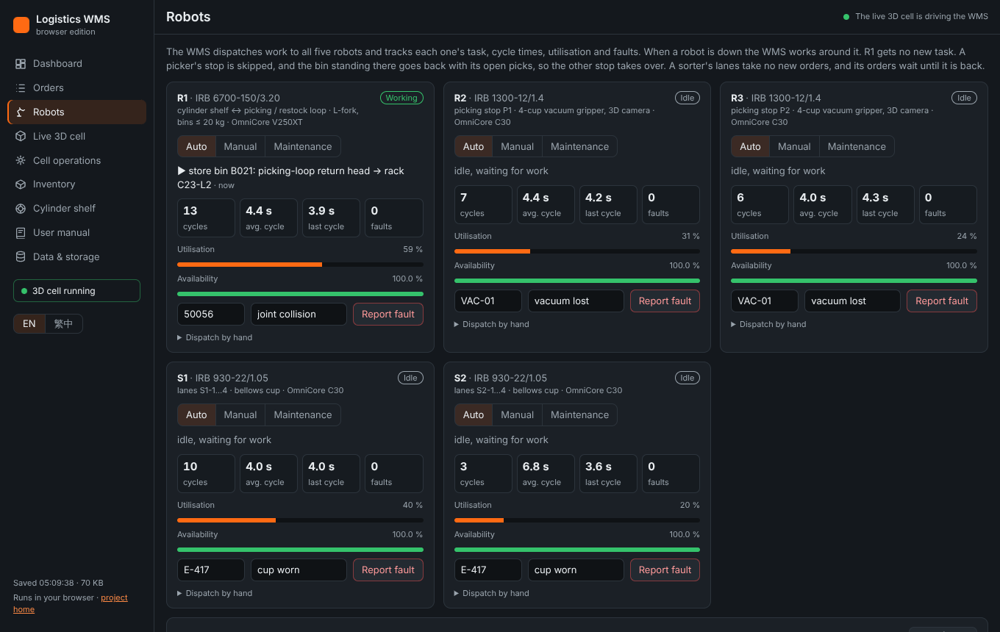
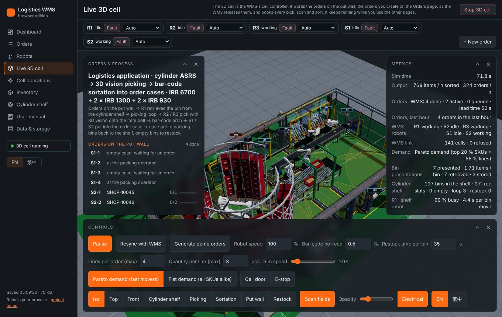
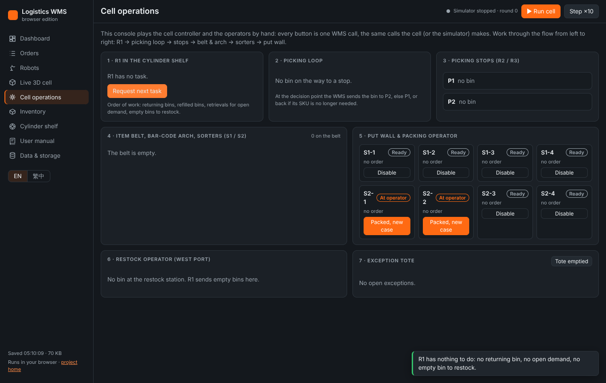
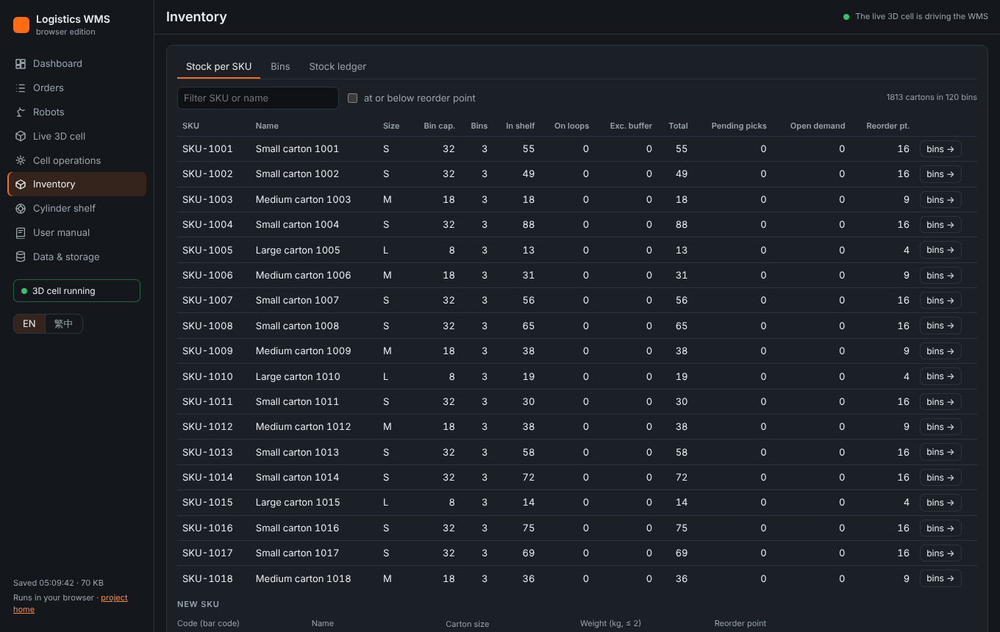
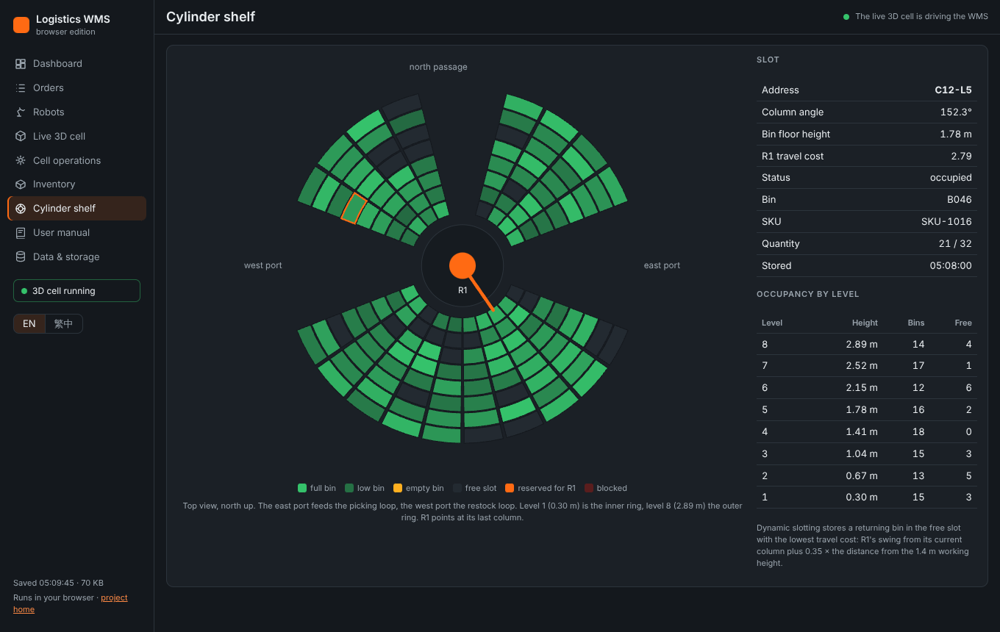
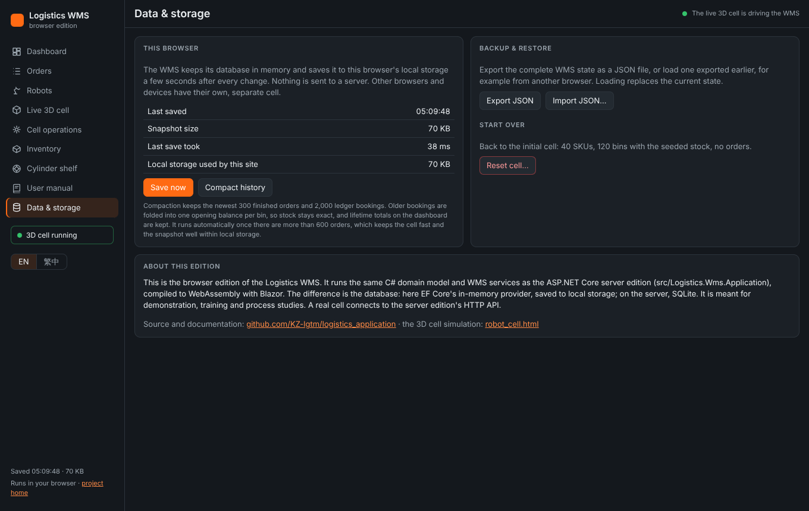

# Logistics WMS — User manual

*Browser edition · English · [繁體中文版](user-manual.zh-Hant.md)*

This manual explains how to work with the Logistics WMS: creating orders, following them through the robot cell, watching the cell in 3D, handling robot faults, keeping stock right, and looking after the data in your browser.

## Contents

1. [What the WMS does](#what-the-wms-does)
2. [Getting started](#getting-started)
3. [Quick start: your first order](#quick-start-your-first-order)
4. [The pages](#the-pages)
5. [How the cell works an order](#how-the-cell-works-an-order)
6. [Common tasks](#common-tasks)
7. [Simulator, 3D cell or console: which one?](#simulator-3d-cell-or-console-which-one)
8. [Troubleshooting](#troubleshooting)
9. [Glossary](#glossary)
10. [Appendix: the server edition](#appendix-the-server-edition)

## What the WMS does

The WMS (warehouse management system) runs a goods-to-robot order-fulfilment cell. It holds the stock and the orders, and makes every decision the cell needs: which bin to fetch, which stop it goes to, which carton belongs to which order, and when an order is finished.

The cell has five robots:

| Robot | Model | Job |
|---|---|---|
| **R1** | IRB 6700 with an L-fork | Moves bins between the cylinder shelf (144 slots) and the two loops. |
| **R2** | IRB 1300, vacuum gripper, 3D camera | Picks cartons out of the bin at picking stop **P1** onto the item belt. |
| **R3** | IRB 1300, vacuum gripper, 3D camera | Does the same at picking stop **P2**. |
| **S1** | IRB 930 SCARA | Takes its cartons off the belt and puts them into the order cases of lanes S1-1 to S1-4. |
| **S2** | IRB 930 SCARA | Does the same for lanes S2-1 to S2-4. |

Two people work at the cell. The **restock operator** refills empty bins outside the west port. The **packing operator** takes finished order cases off the put wall and puts empty cases in.

An order flows like this:

1. You create the order. It waits in the queue until one of the 8 put-wall lanes has an empty case. The WMS then releases it to that lane (one order per lane).
2. The WMS adds up the open lines of all orders on the put wall and has R1 fetch bins of the SKUs that are needed.
3. The bin runs on the picking loop to stop P2 (or P1). R2 or R3 picks the cartons for every order that needs that SKU and places them on the item belt.
4. The bar-code arch reads each carton. The WMS tells the belt which sorter takes it, and S1 or S2 puts it into the right order case.
5. When the last carton is in, the order is complete. The case runs out to the packing operator, an empty case comes in, and the lane takes the next order.
6. R1 stores the bin back in the nearest free slot. Empty bins go to the restock operator, who refills them.

This browser edition runs completely in your web browser. Nothing is sent to a server, and each browser has its own cell.

## Getting started

### Opening the WMS

Open the WMS address, for example `https://kz-lgtm.github.io/logistics_application/wms/`. The first visit downloads about 10 MB (the .NET runtime that runs the WMS in your browser). Later visits load from the browser cache.

The first time, the cell starts with 40 SKUs and 120 bins of stock, and no orders.

### Language

Use **EN / 繁中** at the bottom of the left sidebar to switch between English and Traditional Chinese. The choice is remembered in this browser. The live 3D cell switches with it.

### The screen



* **Left sidebar:** the pages, the language switch, and when the cell was last saved. **3D cell running** appears while the live 3D cell is working.
* **Top bar:** the page title and the quick simulator (**Run cell**, **Step ×10**, **Stop**). While the live 3D cell runs, the top bar shows "The live 3D cell is driving the WMS" instead.
* **Notifications:** confirmations and refusals appear in the bottom-right corner. Click one to close it. Red ones mean the WMS refused something, and the text says why.

### Where your data is kept

The WMS saves its state in this browser's local storage a few seconds after every change. It is still there after you close the tab. To keep a copy or move it to another browser, use **Export JSON** on the **Data & storage** page (see [Backing up and restoring](#backing-up-and-restoring)).

## Quick start: your first order

1. Open **Orders**.
2. Enter a **Reference** (for example your shop order number), choose a SKU, and enter the quantity. Use **+ Line** for more SKUs. An order case takes up to 8 SKUs.
3. Click **Create order**. The notification tells you whether the order went straight to a lane or is waiting in the queue.
4. Click **Watch in 3D** next to the order. The live 3D cell opens. The order's lane label and its cartons turn orange, and the view moves to the put wall.
5. Watch R1 fetch the bin, R2 or R3 pick the cartons, and S1 or S2 put them into the case. The panel on the left counts the cartons (for example 1/2).
6. When the order shows **Completed** on the **Orders** page, it's done. The case runs out to the packing operator.

You can keep working on other pages: the 3D cell keeps running and works every new order you create.

## The pages

### Dashboard

The dashboard shows how the cell is doing:

* **Key figures:** orders and items in the last hour, queued and active orders, average lead time on the put wall, items per bin presentation, bar-code no-read rate, cartons in stock.
* **Put wall:** the 8 lanes, each with its order, progress and state (see [Lane states](#lane-states)).
* **Robots:** what each robot is doing and its utilisation; below that, the bins at the picking stops.
* **Storage**, **Belt & exceptions** and **At or below reorder point:** the shelf, the loops, the belt, the exception tote and low-stock SKUs.
* **Simulator settings:** see [The quick simulator](#the-quick-simulator).

### Orders



* **New order:** reference, priority and lines. Orders with a higher **Priority** are released to the put wall first; within a priority, the oldest order goes first. Lines of the same SKU are merged.
* **Order list:** filter by status with the tabs (All, Queued, Active, Completed, Cancelled). Click a row to see its lines: ordered, allocated (a bin is assigned), picked and sorted quantities, and the lead time.
* **Watch in 3D** opens the live 3D cell focused on that order.
* **Cancel** is offered while an order is queued, or active with no carton picked yet. Once cartons are picked, the order has to be finished.

### Robots



One card per robot shows:

* **Mode:** **Auto** (the WMS gives it work), **Manual** (a technician is working on it) or **Maintenance** (out of service). Click to change.
* **State and task:** idle, working (with the task), or fault.
* **Figures:** cycles, average and last cycle time, faults, utilisation (busy time) and availability (time without a fault).
* **Report fault / Clear fault:** enter a fault code and text to stop the robot, and clear it when it's fixed. See [When a robot is down](#when-a-robot-is-down).
* **Dispatch by hand:** shows what the robot's controller does. **Next task** asks the WMS for work, and **Task done** reports it done.

The **Robot events** table lists faults, mode changes and work the WMS reassigned. **Reset figures** starts the figures from zero.

### Live 3D cell



The live 3D cell shows the real cell with its robots, conveyors and operators. Its robots carry out the WMS's work, and every pick, scan and sort is booked in the WMS.

* **Robot bar** (top): each robot's state. **Fault** injects a fault and **Clear** removes it. The mode list changes the mode.
* **Orders & process** (left panel): the order on each put-wall lane with its progress, and the queue in release order. Click an order to focus it.
* **Lane labels** over the put wall show each lane's order reference and how many cartons are in the case.
* **Metrics** (right panel): output, order figures, the robots as the WMS sees them, and what each machine is doing.
* **Controls** (bottom panel):
  * **Pause** and **Sim speed** (up to 8×).
  * **Resync with WMS** rebuilds the 3D cell from the WMS, for example after you worked in the console.
  * **Generate demo orders** keeps 12 generated orders queued. Leave it off to work only your own orders.
  * **Bar-code no-read**, **Restock time per bin**, robot speed, demand mode.
  * **Cell door** and **E-stop** stop the cell for safety.
  * Camera views (**Iso**, **Top**, **Put wall** …).
* Mouse: drag to rotate, right-drag or Shift-drag to pan, wheel to zoom.

Once started, the 3D cell keeps running while you use the other pages. Nothing is drawn while it's hidden, but it keeps working. **Stop 3D cell** (top right) stops it. The WMS keeps its state, so the quick simulator or the console can carry on.

### Cell operations



The console lets you play the cell controller and the operators by hand, one step at a time. It's useful for training, or to see exactly what the WMS decides. Work from left to right:

1. **R1:** **Request next task**, then **Task done** (or **Cancel task**).
2. **Picking loop:** **Decision point** (the WMS routes the bin to P2, P1 or back), then **Arrived** at the stop.
3. **Picking stops:** **Picked onto belt** for each carton. **Correct count** tells the WMS that the 3D camera sees a different number of cartons.
4. **Item belt:** **Scan**, **No read** or **Wrong code**; then **Put into** the lane, or **Missed** if the sorter didn't take it.
5. **Put wall:** **At operator**, **Packed, new case**, **Case in place**. **Disable** stops a lane taking new orders.
6. **Restock:** set the fill level (an empty bin can take another SKU), then **Done**.
7. **Exception tote:** **Return to stock** or **Scrap** each carton; **Tote emptied** when the tote is empty.

The console is locked while the live 3D cell runs, because the 3D cell books these events itself.

### Inventory



* **Stock per SKU:** stock in the shelf, on the loops and in the exception buffer; pending picks; open demand; and the reorder point (low stock is highlighted). **New SKU** creates a SKU (see [Adding a new SKU](#adding-a-new-sku)).
* **Bins:** every bin with its quantity and location. **Book** posts a cycle count.
* **Stock ledger:** every stock booking. The sum of all bookings is the stock.

### Cylinder shelf



A top view of the 144 slots: level 1 is the inner ring and level 8 the outer ring. Colours show full, low and empty bins, free slots, slots reserved for R1, and blocked slots. Click a slot for its details. **Block for maintenance** takes a free slot out of use, and **Release slot** gives it back.

The WMS stores a returning bin in the free slot that costs R1 the least travel: the shortest swing from where it is, close to the 1.4 m working height.

### Data & storage



* **This browser:** when the cell was last saved and how much space it uses. **Save now** saves immediately.
* **Compact history** archives old finished orders and folds old ledger bookings together. Stock and lifetime figures stay exact. It runs automatically once there are more than 600 orders.
* **Backup & restore:** **Export JSON** downloads the complete state, and **Import JSON…** loads one (it replaces the current state).
* **Start over:** **Reset cell…** goes back to the initial stock with no orders.

## How the cell works an order

### Order states

| State | Meaning |
|---|---|
| **Queued** | Created, waiting for a lane with an empty case. |
| **Active** | On a put-wall lane; cartons are being picked and sorted into its case. |
| **Completed** | All cartons are in the case; the case has gone to packing. |
| **Cancelled** | Cancelled before any carton was picked. |

Line quantities on the order: **Allocated** means assigned to a bin at a stop, **Picked** means on the belt, and **Sorted** means in the case.

### Lane states

| State | Meaning |
|---|---|
| **Ready** | An empty case is in place; the lane takes the next order. |
| **Active** | The case is collecting an order. |
| **Outbound** | The order is complete; the case runs out to the packing operator. |
| **At operator** | The packing operator is taking the case off. |
| **Inbound** | An empty case is running in. |

### Bins

A bin is in the shelf, or on its way:

* on the **picking loop**: inbound, at a stop, or returning;
* on the **restock loop**: at the restock operator, or returning.

R1 works in this order: bins returning from the picking loop first, then refilled bins, then bins for open demand (while the loop has fewer than 7 bins), then empty bins to restock.

### Exceptions

A carton goes to the **exception tote** at the end of the belt when:

* the arch can't read its bar code;
* the bar code is wrong;
* its order is no longer on the put wall;
* its sorter missed it or is down.

Its order line is reopened and picked again from another bin. The operator returns the carton to stock (it goes into the next refill of that SKU) or scraps it.

### When a robot is down

When a robot has a fault, or isn't in **Auto** mode, the WMS gives it no work and works around it:

* **R1:** no new bin moves; the shelf pauses until R1 is back.
* **R2 or R3:** its stop is skipped. The bin standing there goes back with its open picks, and the other stop takes over.
* **S1 or S2:** its lanes take no new orders, and its orders get no new picks until it's back. A carton already on the way to it goes to the exception tote and is picked again later.

The **Robot events** table records the fault and any work the WMS reassigned.

## Common tasks

### Creating and prioritising orders

Create orders on **Orders**. To get an urgent order out first, give it a higher **Priority**: it is released to the next lane that has an empty case.

### Following an order

Use **Watch in 3D** on the **Orders** page, or click the order in the 3D cell's **Orders & process** panel. To follow it in numbers, open the order row on **Orders**.

### Cancelling an order

Click **Cancel** on the order. This works while it is **Queued**, or **Active** with nothing picked yet. Its lane takes the next order.

### Handling a robot fault

1. On **Robots** (or in the 3D cell's robot bar), **Report fault** with the code and text, or click **Fault**.
2. Watch the WMS work around it.
3. When the robot is fixed, **Clear fault**. Its lanes and stop take work again straight away.

For planned work, set the robot to **Maintenance** instead, and back to **Auto** afterwards.

### Counting stock

On **Inventory → Bins**, enter the counted quantity of a bin that is in the shelf (or at the restock operator) and click **Book**. The difference is posted in the stock ledger. A bin at a picking stop is counted with **Correct count** in **Cell operations**.

### Adding a new SKU

On **Inventory → Stock per SKU**, fill in **New SKU** and click **Create SKU**. A new SKU gets stock when the restock operator puts it into an empty bin: in **Cell operations → Restock**, choose the new SKU for an empty bin and click **Done**.

### Handling the exception tote

In **Cell operations → Exception tote**, decide for each carton: **Return to stock** or **Scrap**. Click **Tote emptied** when the tote is empty. While the 3D cell runs, its packing operator empties the tote and returns the cartons to stock by itself.

### Taking a shelf slot out of use

On **Cylinder shelf**, click a free slot and **Block for maintenance**. Release it later with **Release slot**.

### Backing up and restoring

On **Data & storage**, **Export JSON** saves a file with the whole state. **Import JSON…** loads it, in this or another browser, and replaces the current state.

### Starting again

On **Data & storage**, click **Reset cell…**, then **Yes, reset the cell**. All orders and bookings in this browser are deleted.

## Simulator, 3D cell or console: which one?

| | Use it to |
|---|---|
| **Live 3D cell** | Watch the real process work your orders, with real timing, and see how robot faults affect it. This is the normal way to run the cell. |
| **The quick simulator** (**Run cell** in the top bar) | Get through many orders fast. It works in rounds without timing, and is useful for filling the cell with history and figures. |
| **Cell operations** | Go through the process one step at a time by hand, for training or to understand each WMS decision. |

Only one of them drives the cell at a time: the 3D cell switches the quick simulator off, and locks the console.

### The quick simulator

**Run cell** starts it, **Step ×10** runs 10 rounds, and **Stop** stops it. In **Simulator settings** on the dashboard you can set:

* the speed;
* the demand (Pareto: a few SKUs make most of the lines, or Flat);
* the no-read rate;
* the lines and pieces per order;
* **generate demo orders**: keeps 12 generated orders queued. Off: only your own orders.

## Troubleshooting

**My order stays Queued.**
All 8 lanes are busy, or a sorter is down: a sorter's lanes take no new orders while it is down. Check the **Robots** page, and the put wall on the dashboard.

**My order is Active but nothing happens.**
Is anything running the cell? Open the **Live 3D cell**, or start the quick simulator. Check that R1 and the pickers are in **Auto** without a fault, and that the cell door or E-stop isn't on in the 3D cell's controls.

**The 3D cell shows something different from the WMS.**
Click **Resync with WMS** in the 3D cell's controls. This can happen after you changed things in the console while the 3D cell was stopped.

**The 3D cell is slow.**
It needs WebGL; a computer with a graphics card works best. Lower the sim speed, or hide panels you don't need. When the browser tab is in the background, the browser slows it down heavily.

**The WMS refused something (red notification).**
The text says why, for example "Order reference 'X' already exists" or "Order 7 already has picked cartons and cannot be cancelled". Nothing was changed.

**My data is gone.**
The state lives in this browser only. Clearing site data, using a private window, or another browser or device gives an empty cell. Keep exports of anything that matters.

**"Saving to local storage failed".**
The browser's storage is full. Use **Compact history** and **Export JSON** on **Data & storage**.

## Glossary

| Term | Meaning |
|---|---|
| ASRS | Automated storage and retrieval system: the cylinder shelf with R1. |
| Bin | Red bar-coded box holding cartons of one SKU. |
| Carton | One piece of a SKU; the unit that is picked and sorted. |
| Cycle count | Counting the cartons in a bin and posting the difference. |
| Decision point | Where the WMS decides which stop a bin goes to. |
| Dynamic slotting | Storing a bin in the best free slot at that moment instead of a fixed one. |
| Exception tote | Box at the belt end for cartons that couldn't be sorted. |
| Lead time | Time from releasing an order to a lane until its last carton is in the case. |
| Order case | Box on a put-wall lane that collects one order. |
| Picking stop | P1 or P2, where R2 or R3 picks from the bin. |
| Put wall | The 8 powered lanes with the order cases. |
| Reorder point | Stock level at or below which a SKU counts as low. |
| Rolling waves | Releasing a new order as soon as a lane is free, instead of in fixed batches. |
| SKU | Stock-keeping unit: one article. |
| Utilisation | Share of time a robot is busy. |
| Availability | Share of time a robot is without a fault. |

## Appendix: the server edition

The same WMS also runs as an ASP.NET Core service for a real cell. The cell controller (PLC / WCS) and operator panels talk to it over HTTP. To run it with the .NET 10 SDK:

```bash
dotnet run --project src/Logistics.Wms.Api --urls http://localhost:5213
```

Then open `http://localhost:5213/` for its dashboard, and `http://localhost:5213/openapi/v1.json` for the API description. Main endpoints:

| Area | Endpoints |
|---|---|
| Orders | `GET/POST /api/orders`, `POST /api/orders/{id}/cancel` |
| Robots | `GET /api/robots`, `POST /api/robots/{id}/tasks/next`, `POST /api/robots/{id}/tasks/{ref}/complete`, `POST /api/robots/{id}/fault`, `…/fault/clear`, `…/mode` |
| R1 | `POST /api/asrs/tasks/next`, `…/{id}/complete` |
| Picking | `POST /api/picking/bins/{bin}/route`, `…/stations/{P1/P2}/arrive/{bin}`, `…/picks/{id}/confirm` |
| Sortation | `POST /api/sortation/scan`, `POST /api/sortation/sort` |
| Put wall | `POST /api/putwall/lanes/{id}/events/{event}` |
| Stock | `GET /api/inventory/skus`, `…/bins`, `…/transactions`, `POST …/bins/{id}/adjust` |

The server edition has no user login yet: run it inside the plant network. See the project README for details.
