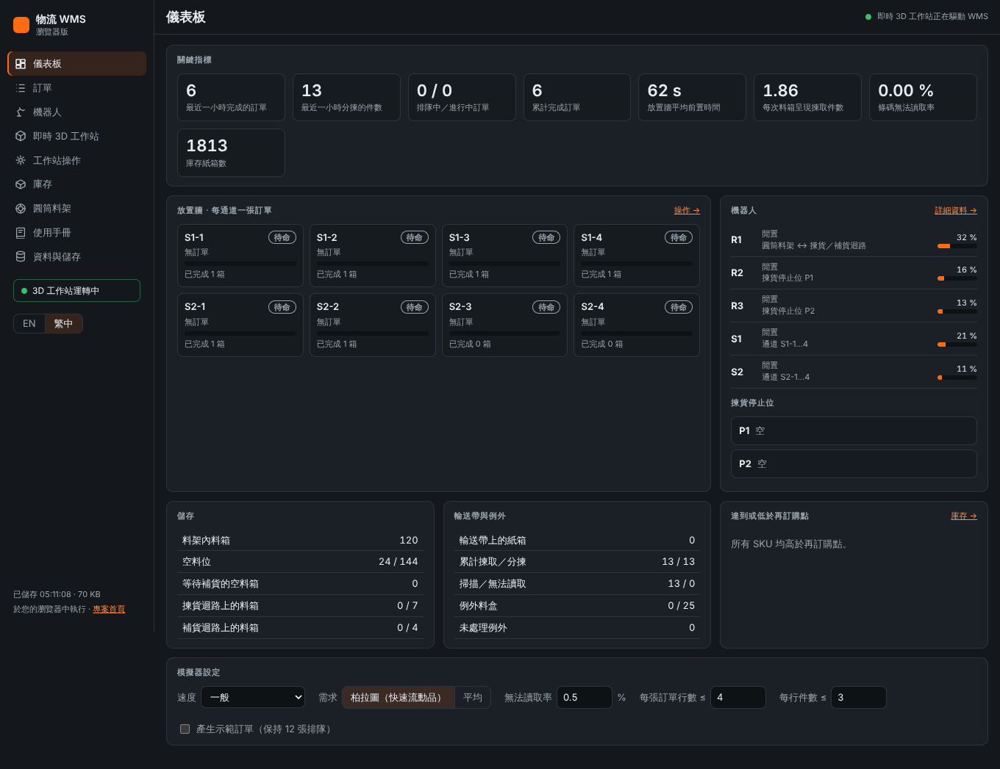
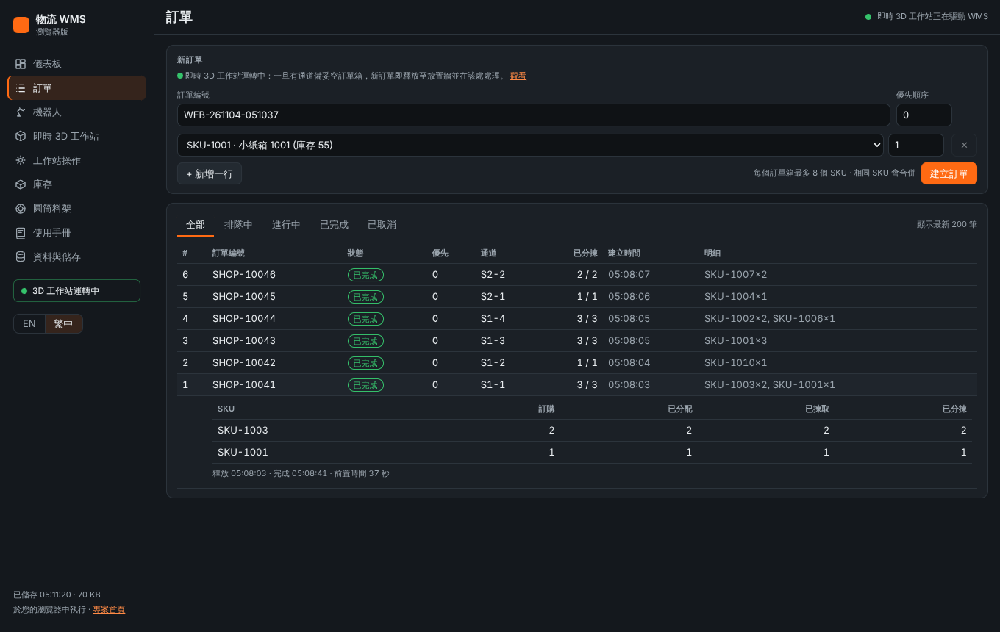
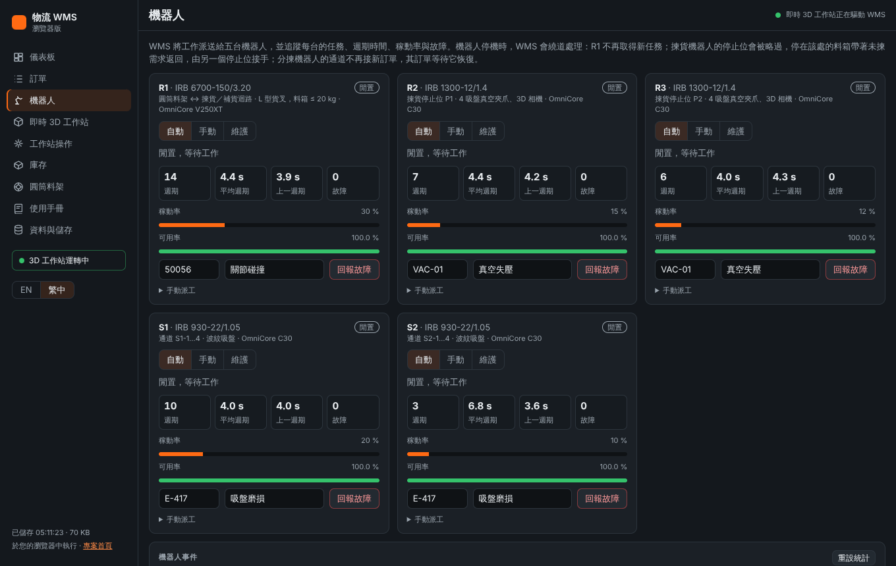
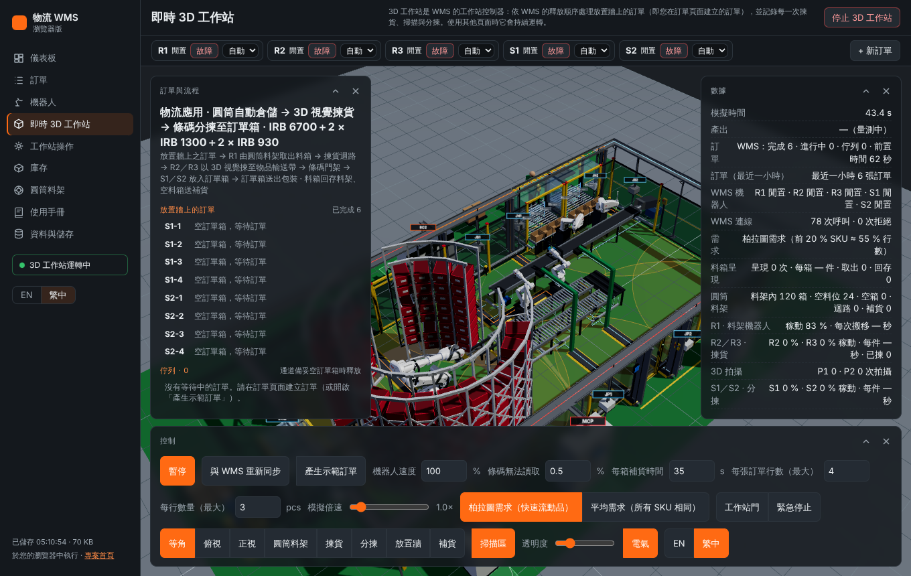
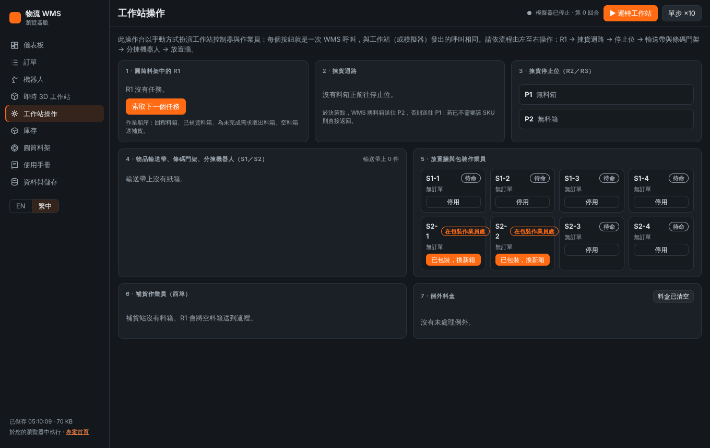
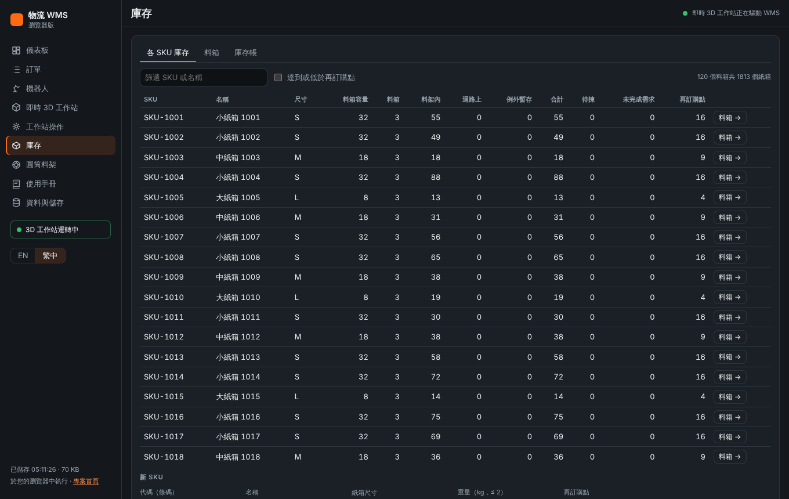
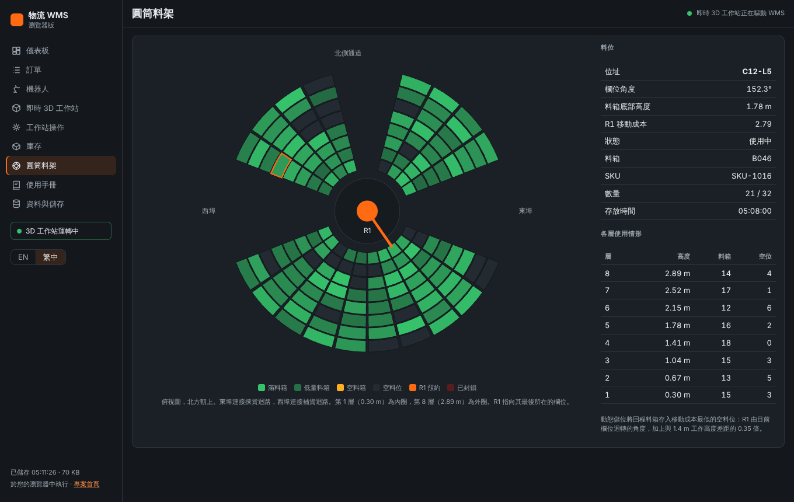
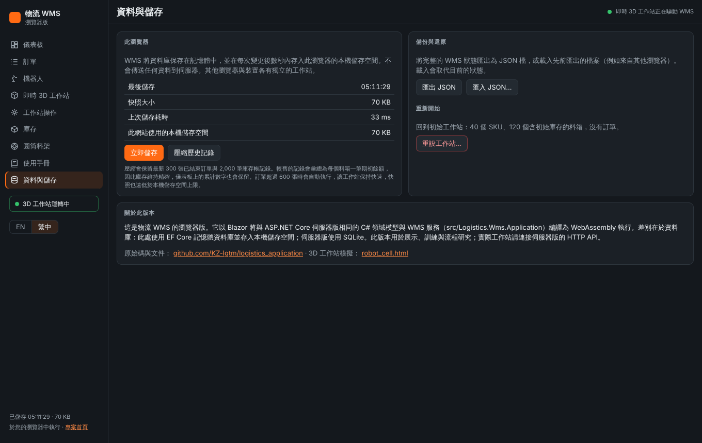

# 物流 WMS 使用手冊

*瀏覽器版 · 繁體中文 · [English version](user-manual.en.md)*

本手冊說明如何使用物流 WMS：建立訂單、追蹤訂單在機器人工作站中的處理過程、以 3D 觀看工作站、處理機器人故障、維持庫存正確，以及管理保存在瀏覽器中的資料。

## 目錄

1. [WMS 的功能](#overview)
2. [開始使用](#getting-started)
3. [快速上手：處理第一張訂單](#quick-start)
4. [各頁面說明](#pages)
5. [工作站如何處理訂單](#process)
6. [常見作業](#tasks)
7. [模擬器、3D 工作站或操作台：該用哪一個？](#which-one)
8. [疑難排解](#troubleshooting)
9. [名詞解釋](#glossary)
10. [附錄：伺服器版](#server-edition)

<a id="overview"></a>
## WMS 的功能

WMS（倉儲管理系統）負責管理一座「貨到機器人」的訂單履行工作站。它保存庫存與訂單，並做出工作站所需的每一個決策：取出哪一個料箱、料箱送往哪個停止位、每個紙箱屬於哪張訂單，以及訂單何時完成。

工作站有五台機器人：

| 機器人 | 型號 | 工作 |
|---|---|---|
| **R1** | IRB 6700，L 型貨叉 | 在圓筒料架（144 個料位）與兩條迴路之間搬移料箱。 |
| **R2** | IRB 1300，真空夾爪、3D 相機 | 從揀貨停止位 **P1** 的料箱中揀取紙箱，放上物品輸送帶。 |
| **R3** | IRB 1300，真空夾爪、3D 相機 | 在揀貨停止位 **P2** 執行相同工作。 |
| **S1** | IRB 930 SCARA | 從輸送帶取下屬於自己的紙箱，放入通道 S1-1 至 S1-4 的訂單箱。 |
| **S2** | IRB 930 SCARA | 對通道 S2-1 至 S2-4 執行相同工作。 |

工作站另有兩位作業員：**補貨作業員**在西埠外為空料箱補貨；**包裝作業員**從放置牆取走完成的訂單箱並放入空訂單箱。

訂單的處理流程如下：

1. 您建立訂單。訂單在佇列中等待，直到 8 條放置牆通道中有一條備妥空訂單箱，WMS 便將訂單釋放到該通道（每通道一張訂單）。
2. WMS 彙總放置牆上所有訂單的未完成明細，指示 R1 取出所需 SKU 的料箱。
3. 料箱經揀貨迴路送往停止位 P2（或 P1）。R2 或 R3 為所有需要該 SKU 的訂單揀取紙箱，放上物品輸送帶。
4. 條碼門架讀取每個紙箱。WMS 告訴輸送帶由哪台分揀機器人接手，S1 或 S2 將紙箱放入正確的訂單箱。
5. 最後一個紙箱放入後，訂單即完成。訂單箱送往包裝作業員，空訂單箱送入，通道接下一張訂單。
6. R1 將料箱存回最近的空料位。空料箱送往補貨作業員補貨。

本瀏覽器版完全在您的網頁瀏覽器中執行。資料不會傳送到任何伺服器，每個瀏覽器各有獨立的工作站。

<a id="getting-started"></a>
## 開始使用

### 開啟 WMS

開啟 WMS 的網址，例如 `https://kz-lgtm.github.io/logistics_application/wms/`。第一次開啟時約需下載 10 MB（讓 WMS 在瀏覽器中執行的 .NET 執行環境），之後會從瀏覽器快取載入。

第一次使用時，工作站有 40 個 SKU 與 120 個有庫存的料箱，沒有任何訂單。

### 語言

使用左側選單底部的 **EN / 繁中** 切換英文與繁體中文。此選擇會記錄在這個瀏覽器中，即時 3D 工作站也會一起切換。

### 畫面配置



* **左側選單：** 各頁面、語言切換與最後儲存時間。即時 3D 工作站運作時會顯示 **3D 工作站運轉中**。
* **頂部列：** 頁面標題與快速模擬器（**運轉工作站**、**單步 ×10**、**停止**）。即時 3D 工作站運轉時，此處改為顯示「即時 3D 工作站正在驅動 WMS」。
* **通知：** 確認與拒絕訊息會出現在右下角，點一下即可關閉。紅色表示 WMS 拒絕了某項操作，訊息內容會說明原因。

### 資料保存在哪裡

每次變更後數秒內，WMS 會將狀態存入此瀏覽器的本機儲存空間，關閉分頁後資料仍會保留。若要保留副本或移到其他瀏覽器，請使用 **資料與儲存** 頁面的 **匯出 JSON**（請參閱[備份與還原](#backup)）。

<a id="quick-start"></a>
## 快速上手：處理第一張訂單

1. 開啟 **訂單**。
2. 輸入 **訂單編號**（例如您的網店訂單號碼），選擇 SKU 並輸入數量。需要更多 SKU 時按 **+ 新增一行**。每個訂單箱最多 8 個 SKU。
3. 按 **建立訂單**。通知會告訴您訂單已直接釋放至通道，或正在佇列中等待。
4. 按該訂單旁的 **3D 觀看**。即時 3D 工作站隨即開啟：該訂單的通道標籤與紙箱變成橘色，視角移到放置牆。
5. 觀看 R1 取出料箱、R2 或 R3 揀取紙箱、S1 或 S2 將紙箱放入訂單箱。左側面板會計數紙箱（例如 1/2）。
6. 當 **訂單** 頁面顯示 **已完成**，訂單即處理完畢，訂單箱送往包裝作業員。

您可以繼續使用其他頁面：3D 工作站會持續運轉，並處理您新建立的每一張訂單。

<a id="pages"></a>
## 各頁面說明

### 儀表板

儀表板顯示工作站的運作狀況：

* **關鍵指標：** 最近一小時的訂單與件數、排隊中／進行中訂單、放置牆平均前置時間、每次料箱呈現揀取件數、條碼無法讀取率、庫存紙箱數。
* **放置牆：** 8 條通道，各自顯示訂單、進度與狀態（請參閱[通道狀態](#lane-states)）。
* **機器人：** 每台機器人正在做什麼及其稼動率；下方為揀貨停止位上的料箱。
* **儲存**、**輸送帶與例外**、**達到或低於再訂購點：** 料架、迴路、輸送帶、例外料盒與低庫存 SKU。
* **模擬器設定：** 請參閱[快速模擬器](#quick-simulator)。

### 訂單



* **新訂單：** 訂單編號、優先順序與明細。**優先順序**較高的訂單先釋放至放置牆；相同優先順序時，較早的訂單先釋放。相同 SKU 的明細會合併。
* **訂單清單：** 以分頁標籤依狀態篩選（全部、排隊中、進行中、已完成、已取消）。點一下列即可查看明細：訂購、已分配（已指派料箱）、已揀取、已分揀數量，以及前置時間。
* **3D 觀看** 會開啟即時 3D 工作站並聚焦於該訂單。
* **取消** 在訂單排隊中，或進行中但尚未揀取任何紙箱時可用。一旦有紙箱已揀取，訂單就必須完成。

### 機器人



每台機器人一張卡片，顯示：

* **模式：** **自動**（WMS 派工給它）、**手動**（技術人員正在操作）或 **維護**（停用中）。點選即可切換。
* **狀態與任務：** 閒置、作業中（含任務內容）或故障。
* **統計：** 週期次數、平均與上一週期時間、故障次數、稼動率（忙碌時間）與可用率（無故障時間）。
* **回報故障／排除故障：** 輸入故障代碼與說明即可讓機器人停止，修復後再排除。請參閱[機器人停機時](#robot-down)。
* **手動派工：** 示範機器人控制器的動作：**下一個任務** 向 WMS 索取工作，**任務完成** 回報完成。

**機器人事件** 表格列出故障、模式變更與 WMS 重新分派的工作。**重設統計** 讓統計從零開始。

### 即時 3D 工作站



即時 3D 工作站以真實的機器人、輸送設備與作業員呈現工作站。機器人執行 WMS 指派的工作，每一次揀貨、掃描與分揀都記錄在 WMS 中。

* **機器人列**（上方）：每台機器人的狀態。**故障** 注入故障，**排除** 解除故障，模式清單可切換模式。
* **訂單與流程**（左側面板）：每條放置牆通道上的訂單與進度，以及依釋放順序排列的佇列。點選訂單即可聚焦。
* **通道標籤** 顯示在放置牆上方：每條通道的訂單編號與訂單箱中的紙箱數。
* **數據**（右側面板）：產出、訂單統計、WMS 所見的機器人狀態，以及各設備正在做什麼。
* **控制**（下方面板）：
  * **暫停** 與 **模擬倍速**（最高 8 倍）。
  * **與 WMS 重新同步** 依 WMS 狀態重建 3D 工作站，例如在操作台作業之後。
  * **產生示範訂單** 會保持 12 張產生的訂單排隊；若只要處理自己的訂單，請保持關閉。
  * **條碼無法讀取**、**每箱補貨時間**、機器人速度、需求模式。
  * **工作站門** 與 **緊急停止** 讓工作站安全停止。
  * 視角（**等角**、**俯視**、**放置牆**…）。
* 滑鼠：拖曳旋轉，右鍵拖曳或 Shift＋拖曳平移，滾輪縮放。

3D 工作站啟動後，在您使用其他頁面時會持續運轉。隱藏時不繪製畫面，但工作照常進行。按右上角的 **停止 3D 工作站** 即可停止，WMS 會保留狀態，可由快速模擬器或操作台接續。

### 工作站操作



操作台讓您以手動方式、一步一步扮演工作站控制器與作業員，適合訓練，或用來了解 WMS 的每一個決策。請由左至右操作：

1. **R1：** **索取下一個任務**，接著 **任務完成**（或 **取消任務**）。
2. **揀貨迴路：** **決策點**（WMS 將料箱送往 P2、P1 或直接返回），接著在停止位 **已到達**。
3. **揀貨停止位：** 每個紙箱按 **已揀放上輸送帶**。若 3D 相機看到的數量不同，以 **修正數量** 告訴 WMS。
4. **物品輸送帶：** **掃描**、**無法讀取** 或 **條碼錯誤**；接著 **放入** 通道，若分揀機器人沒有取件則按 **漏取**。
5. **放置牆：** **已到作業員處**、**已包裝，換新箱**、**訂單箱就位**。**停用** 讓通道不再接新訂單。
6. **補貨：** 設定補至的數量（空料箱可改放其他 SKU），接著按 **完成**。
7. **例外料盒：** 每個紙箱選擇 **退回庫存** 或 **報廢**；料盒清空後按 **料盒已清空**。

即時 3D 工作站運轉時，操作台會鎖定，因為 3D 工作站會自行記錄這些事件。

### 庫存



* **各 SKU 庫存：** 料架內、迴路上與例外暫存的庫存、待揀、未完成需求與再訂購點（低庫存會標示）。**新 SKU** 用來建立 SKU（請參閱[新增 SKU](#new-sku)）。
* **料箱：** 每個料箱的數量與位置。**過帳** 登錄盤點結果。
* **庫存帳：** 每一筆庫存異動。所有記錄加總即為庫存。

### 圓筒料架



144 個料位的俯視圖：第 1 層為內圈，第 8 層為外圈。顏色代表滿料箱、低量料箱、空料箱、空料位、R1 預約與已封鎖的料位。點選料位可查看詳細資料。**封鎖以進行維護** 讓空料位停止使用，**解除封鎖** 恢復使用。

WMS 會將回程料箱存入讓 R1 移動成本最低的空料位：迴轉角度最小、且接近 1.4 m 工作高度。

### 資料與儲存



* **此瀏覽器：** 最後儲存時間與使用的空間。**立即儲存** 會馬上儲存。
* **壓縮歷史記錄** 會封存舊的已結束訂單，並彙總舊的庫存帳記錄，庫存與累計數字維持精確。訂單超過 600 張時會自動執行。
* **備份與還原：** **匯出 JSON** 下載完整狀態，**匯入 JSON…** 載入檔案（會取代目前狀態）。
* **重新開始：** **重設工作站…** 回到初始庫存且沒有訂單的狀態。

<a id="process"></a>
## 工作站如何處理訂單

### 訂單狀態

| 狀態 | 說明 |
|---|---|
| **排隊中** | 已建立，等待備妥空訂單箱的通道。 |
| **進行中** | 在放置牆通道上，紙箱正被揀取並分揀到它的訂單箱。 |
| **已完成** | 所有紙箱都已放入訂單箱，訂單箱已送往包裝。 |
| **已取消** | 在揀取任何紙箱前被取消。 |

訂單明細的數量：**已分配** 表示已指派給停止位的料箱，**已揀取** 表示在輸送帶上，**已分揀** 表示已放入訂單箱。

<a id="lane-states"></a>
### 通道狀態

| 狀態 | 說明 |
|---|---|
| **待命** | 空訂單箱已就位，通道接下一張訂單。 |
| **收集中** | 訂單箱正在收集一張訂單。 |
| **送出中** | 訂單已完成，訂單箱送往包裝作業員。 |
| **在包裝作業員處** | 包裝作業員正在取下訂單箱。 |
| **空箱送入中** | 空訂單箱正在送入。 |

### 料箱

料箱在料架中，或正在移動：

* 在 **揀貨迴路** 上：入口段、停止位或回程；
* 在 **補貨迴路** 上：補貨作業員處或回程。

R1 的作業順序：先處理揀貨迴路的回程料箱，其次是已補貨的料箱，再來是為未完成需求取出料箱（迴路上料箱少於 7 個時），最後是空料箱送補貨。

### 例外

以下情況，紙箱會進入輸送帶末端的 **例外料盒**：

* 條碼門架無法讀取條碼；
* 條碼錯誤；
* 其訂單已不在放置牆上；
* 分揀機器人漏取或停機。

該訂單行會重新開放，並從另一個料箱再揀取一次。作業員將紙箱退回庫存（併入該 SKU 下一次補貨）或報廢。

<a id="robot-down"></a>
### 機器人停機時

機器人故障或不在 **自動** 模式時，WMS 不派工給它，並繞道處理：

* **R1：** 不再搬移料箱，料架作業暫停，直到 R1 恢復。
* **R2 或 R3：** 其停止位會被略過，停在該處的料箱帶著未揀需求返回，由另一個停止位接手。
* **S1 或 S2：** 其通道不再接新訂單，其訂單也不再產生新的揀貨，直到它恢復。正在送往它的紙箱會進入例外料盒，稍後重新揀取。

**機器人事件** 表格會記錄故障與 WMS 重新分派的工作。

<a id="tasks"></a>
## 常見作業

### 建立訂單與設定優先順序

在 **訂單** 頁面建立訂單。要讓急件先處理，請設定較高的 **優先順序**：它會被釋放到下一條備妥空訂單箱的通道。

### 追蹤訂單

在 **訂單** 頁面按 **3D 觀看**，或在 3D 工作站的 **訂單與流程** 面板中點選訂單。若要看數字，請在 **訂單** 頁面展開該訂單列。

### 取消訂單

按訂單的 **取消**。訂單為 **排隊中**，或 **進行中** 但尚未揀取時才可取消，其通道會接下一張訂單。

### 處理機器人故障

1. 在 **機器人** 頁面（或 3D 工作站的機器人列）以代碼與說明 **回報故障**，或按 **故障**。
2. 觀看 WMS 如何繞道處理。
3. 機器人修復後按 **排除故障**，其通道與停止位會立即重新接受工作。

計畫性作業請改將機器人設為 **維護**，完成後再設回 **自動**。

### 盤點庫存

在 **庫存 → 料箱** 中，輸入料架內（或在補貨作業員處）料箱的盤點數量，按 **過帳**。差異會登錄在庫存帳中。位於揀貨停止位的料箱，請在 **工作站操作** 中以 **修正數量** 盤點。

<a id="new-sku"></a>
### 新增 SKU

在 **庫存 → 各 SKU 庫存** 填寫 **新 SKU**，按 **建立 SKU**。新 SKU 要等補貨作業員將它放入空料箱後才會有庫存：在 **工作站操作 → 補貨** 中為空料箱選擇新的 SKU，按 **完成**。

### 處理例外料盒

在 **工作站操作 → 例外料盒** 中，為每個紙箱選擇 **退回庫存** 或 **報廢**；料盒清空後按 **料盒已清空**。3D 工作站運轉時，其包裝作業員會自行清空料盒並將紙箱退回庫存。

### 停用料架料位

在 **圓筒料架** 點選空料位，按 **封鎖以進行維護**。之後以 **解除封鎖** 恢復。

<a id="backup"></a>
### 備份與還原

在 **資料與儲存** 頁面，**匯出 JSON** 會儲存包含完整狀態的檔案；**匯入 JSON…** 可在此瀏覽器或其他瀏覽器載入該檔案，並取代目前狀態。

### 重新開始

在 **資料與儲存** 頁面按 **重設工作站…**，再按 **是，重設工作站**。此瀏覽器中的所有訂單與記錄都會被刪除。

<a id="which-one"></a>
## 模擬器、3D 工作站或操作台：該用哪一個？

| | 用途 |
|---|---|
| **即時 3D 工作站** | 觀看真實流程以真實節奏處理您的訂單，並了解機器人故障的影響。這是運轉工作站的一般方式。 |
| **快速模擬器**（頂部列的 **運轉工作站**） | 快速處理大量訂單。以回合方式運作、不含時間節奏，適合累積歷史記錄與統計數字。 |
| **工作站操作** | 以手動方式一步一步走完流程，用於訓練或了解 WMS 的每個決策。 |

同一時間只會由其中一種驅動工作站：3D 工作站運轉時會關閉快速模擬器並鎖定操作台。

<a id="quick-simulator"></a>
### 快速模擬器

**運轉工作站** 啟動，**單步 ×10** 執行 10 個回合，**停止** 停止。在儀表板的 **模擬器設定** 中可設定：

* 速度；
* 需求（柏拉圖：少數 SKU 占大部分明細，或平均）；
* 無法讀取率；
* 每張訂單行數與每行件數；
* **產生示範訂單**：保持 12 張產生的訂單排隊。關閉時只處理您自己的訂單。

<a id="troubleshooting"></a>
## 疑難排解

**訂單一直是「排隊中」。**
8 條通道都在忙，或有分揀機器人停機：分揀機器人停機時，它的通道不接新訂單。請檢查 **機器人** 頁面與儀表板上的放置牆。

**訂單是「進行中」，但沒有任何動靜。**
是否有東西在驅動工作站？請開啟 **即時 3D 工作站**，或啟動快速模擬器。確認 R1 與揀貨機器人為 **自動** 且沒有故障，並確認 3D 工作站控制中的工作站門或緊急停止沒有開啟。

**3D 工作站顯示的內容與 WMS 不同。**
在 3D 工作站的控制中按 **與 WMS 重新同步**。這可能發生在 3D 工作站停止期間，您在操作台做了變更之後。

**3D 工作站很慢。**
它需要 WebGL，有顯示卡的電腦效果最好。請降低模擬倍速，或隱藏不需要的面板。瀏覽器分頁在背景時，瀏覽器會大幅降低它的速度。

**WMS 拒絕了某項操作（紅色通知）。**
訊息會說明原因，例如「訂單編號「X」已存在」或「訂單 7 已有揀取的紙箱，無法取消」。系統沒有做任何變更。

**我的資料不見了。**
狀態只保存在這個瀏覽器中。清除網站資料、使用私密視窗，或換用其他瀏覽器或裝置，都會看到空的工作站。重要的資料請匯出保存。

**「儲存至本機儲存空間失敗」。**
瀏覽器的儲存空間已滿。請在 **資料與儲存** 頁面使用 **壓縮歷史記錄** 與 **匯出 JSON**。

<a id="glossary"></a>
## 名詞解釋

| 名詞 | 說明 |
|---|---|
| 自動倉儲（ASRS） | 自動存取系統：圓筒料架與 R1。 |
| 料箱 | 紅色、貼有條碼的箱子，裝同一 SKU 的紙箱。 |
| 紙箱 | SKU 的一件；揀取與分揀的單位。 |
| 循環盤點 | 清點料箱中的紙箱數並登錄差異。 |
| 決策點 | WMS 決定料箱送往哪個停止位的位置。 |
| 動態儲位 | 將料箱存入當下最佳的空料位，而非固定料位。 |
| 例外料盒 | 輸送帶末端的箱子，收集無法分揀的紙箱。 |
| 前置時間 | 自訂單釋放至通道起，至最後一個紙箱放入訂單箱為止的時間。 |
| 訂單箱 | 放置牆通道上收集一張訂單的箱子。 |
| 揀貨停止位 | P1 或 P2，R2 或 R3 在此從料箱揀貨。 |
| 放置牆 | 放置訂單箱的 8 條動力通道。 |
| 再訂購點 | 庫存達到或低於此數量時，SKU 視為低庫存。 |
| 滾動波次 | 一有通道空出就釋放新訂單，而非固定批次。 |
| SKU | 庫存單位：一種商品。 |
| 稼動率 | 機器人忙碌時間的比例。 |
| 可用率 | 機器人無故障時間的比例。 |

<a id="server-edition"></a>
## 附錄：伺服器版

同一套 WMS 也可作為 ASP.NET Core 服務執行，供實際工作站使用。工作站控制器（PLC／WCS）與操作面板透過 HTTP 與它溝通。使用 .NET 10 SDK 執行：

```bash
dotnet run --project src/Logistics.Wms.Api --urls http://localhost:5213
```

接著開啟 `http://localhost:5213/` 查看其儀表板，`http://localhost:5213/openapi/v1.json` 為 API 說明。主要端點：

| 範圍 | 端點 |
|---|---|
| 訂單 | `GET/POST /api/orders`、`POST /api/orders/{id}/cancel` |
| 機器人 | `GET /api/robots`、`POST /api/robots/{id}/tasks/next`、`POST /api/robots/{id}/tasks/{ref}/complete`、`POST /api/robots/{id}/fault`、`…/fault/clear`、`…/mode` |
| R1 | `POST /api/asrs/tasks/next`、`…/{id}/complete` |
| 揀貨 | `POST /api/picking/bins/{bin}/route`、`…/stations/{P1/P2}/arrive/{bin}`、`…/picks/{id}/confirm` |
| 分揀 | `POST /api/sortation/scan`、`POST /api/sortation/sort` |
| 放置牆 | `POST /api/putwall/lanes/{id}/events/{event}` |
| 庫存 | `GET /api/inventory/skus`、`…/bins`、`…/transactions`、`POST …/bins/{id}/adjust` |

伺服器版目前尚無使用者登入功能，請在廠區內部網路中執行。詳細資訊請參閱專案的 README。
